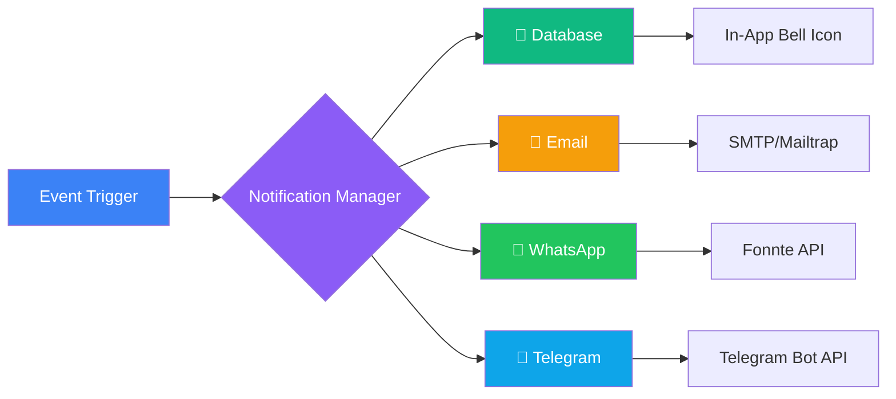
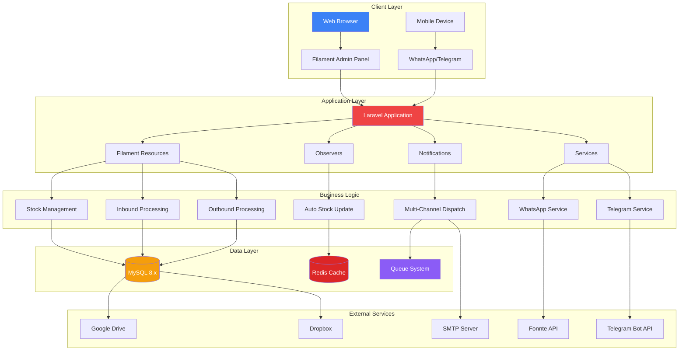
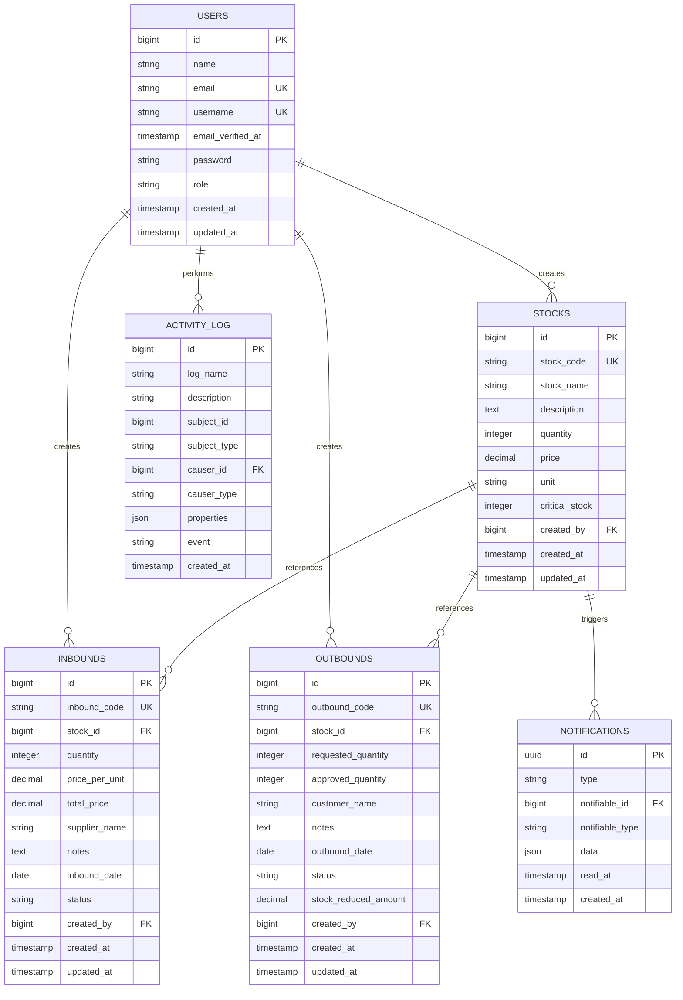
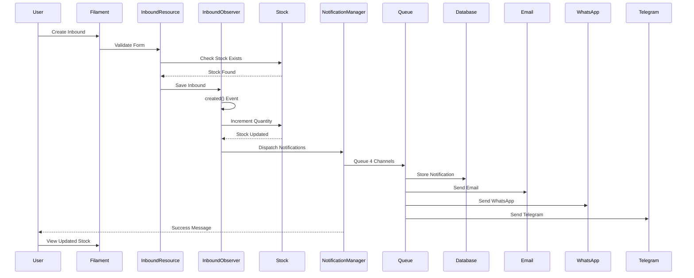
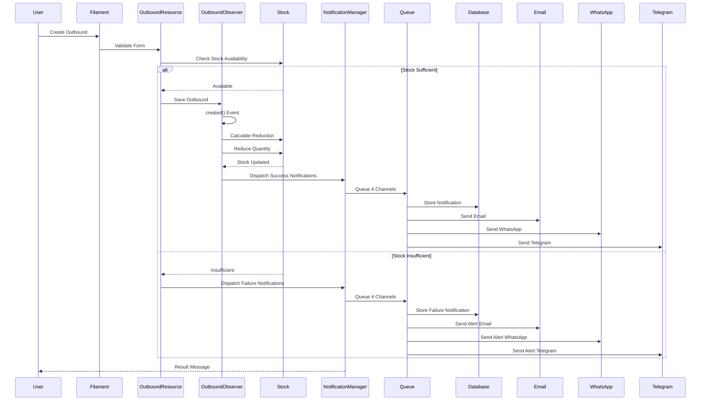
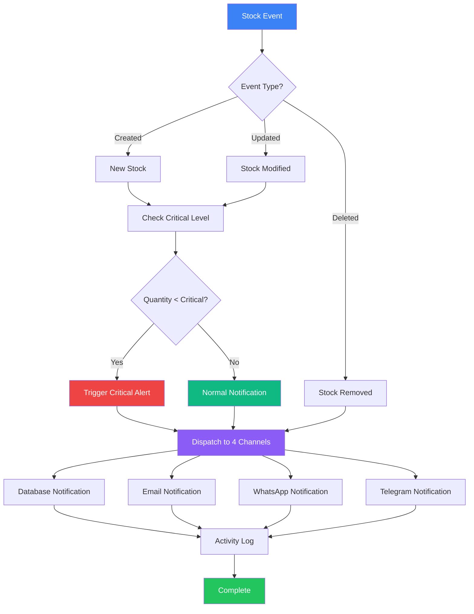
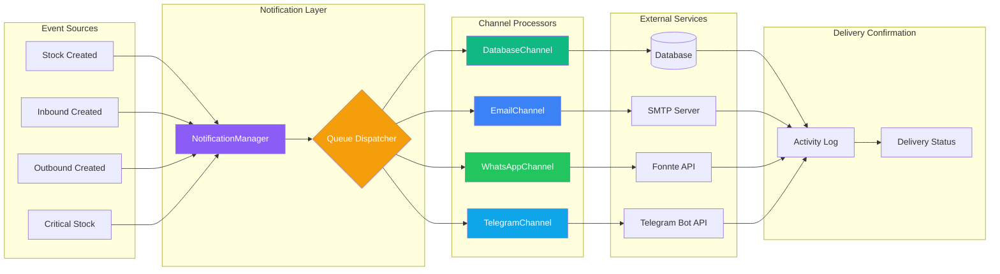
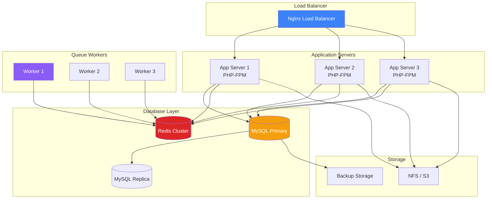

# 🏭 WareX Management System

<div align="center">


**Modern Warehouse Management with Real-Time Inventory Tracking**  
_Enterprise-ready system with reactive validation, automated sync, and comprehensive access control_

[Features](#-features) • [Quick Start](#-quick-start) • [Deployment](DEPLOYMENT.md) • [API](#-api-documentation) • [Support](#-support)


</div>

---

## 📑 Table of Contents

-   [Overview](#-overview)
-   [Core Features](#-core-features)
-   [System Architecture](#-system-architecture)
-   [Technology Stack](#-technology-stack)
-   [Database Schema](#-database-schema)
-   [Workflow Diagrams](#-workflow-diagrams)
-   [Quick Start](#-quick-start)
-   [Configuration](#-configuration)
-   [Notification System](#-notification-system)
-   [Security Features](#-security-features)
-   [Performance Optimization](#-performance-optimization)
-   [API Documentation](#-api-documentation)
-   [Testing](#-testing)
-   [Production Deployment](#-production-deployment)
-   [Monitoring & Maintenance](#-monitoring--maintenance)
-   [Troubleshooting](#-troubleshooting)
-   [Contributing](#-contributing)
-   [License](#-license)

---

## 🎯 Overview

**Warex** adalah sistem manajemen gudang enterprise yang dibangun dengan Laravel 12 dan Filament 3, dirancang untuk mengelola stok barang, transaksi inbound/outbound, dan notifikasi real-time melalui 4 channel berbeda.

### Key Highlights

✅ **Real-time Notifications** - Database, Email, WhatsApp, Telegram  
✅ **Automated Stock Management** - Auto-reduce stock on outbound, auto-restore on inbound  
✅ **Activity Logging** - Complete audit trail untuk semua operasi  
✅ **Multi-Channel Alerts** - Critical stock level alerts  
✅ **Excel & PDF Export** - Comprehensive reporting  
✅ **Automated Backup** - Daily backup ke Google Drive & Dropbox  
✅ **Role-Based Access** - Filament Shield integration  
✅ **Redis Caching** - High-performance data access

---

## 🚀 Core Features

### 1. Stock Management

-   ✅ Real-time stock tracking dengan update otomatis
-   ✅ Multi-location warehouse support
-   ✅ Batch & serial number tracking
-   ✅ Low stock threshold alerts (critical: 10, warning: 20)
-   ✅ Stock adjustment history dengan activity log
-   ✅ Barcode/QR code generation

### 2. Inbound Operations

-   ✅ Purchase order management
-   ✅ Goods receipt processing
-   ✅ Quality control checkpoints
-   ✅ Automatic stock increment
-   ✅ Supplier tracking & evaluation
-   ✅ Multi-item batch processing

### 3. Outbound Operations

-   ✅ Sales order fulfillment
-   ✅ Picking & packing workflows
-   ✅ Automatic stock reduction
-   ✅ Shipping integration ready
-   ✅ Customer order tracking
-   ✅ Return merchandise authorization (RMA)

### 4. Notification System (4 Channels)



**Supported Events:**

-   ✅ Stock created/updated/deleted
-   ✅ Inbound created/updated/deleted
-   ✅ Outbound created/updated/deleted
-   ✅ Critical stock level reached (<10 units)
-   ✅ Failed stock reduction attempts

### 5. Activity Logging

-   ✅ Complete audit trail (spatie/laravel-activitylog)
-   ✅ User action tracking
-   ✅ Before/after state comparison
-   ✅ IP address & user agent logging
-   ✅ Searchable & filterable logs
-   ✅ Automatic log pruning (90 days retention)

### 6. Backup System

-   ✅ Automated daily backups (spatie/laravel-backup)
-   ✅ Database + files backup
-   ✅ Google Drive integration
-   ✅ Dropbox integration
-   ✅ Backup health monitoring
-   ✅ Email notifications on backup failure

### 7. Export & Reporting

-   ✅ Excel export (Maatwebsite Excel)
-   ✅ PDF export (DomPDF) - _In Progress_
-   ✅ Custom date range filtering
-   ✅ Multi-format support (XLS, XLSX, CSV)
-   ✅ Bulk export capabilities

---

## 🏗️ System Architecture



### Architecture Principles

1. **Separation of Concerns** - Models, Observers, Services terpisah dengan baik
2. **Event-Driven** - Menggunakan Laravel Events & Observers
3. **Queue-Based** - Notifikasi via queue untuk performance
4. **Cache-First** - Redis untuk data yang sering diakses
5. **Service-Oriented** - External API calls dalam Services
6. **Observer Pattern** - Auto stock update via Eloquent Observers

---

## 💻 Technology Stack

### Backend Framework

-   **Laravel 12.38.1** - Latest LTS dengan PHP 8.4 support
-   **Filament 3.3.45** - Modern admin panel dengan Livewire
-   **PHP 8.4.14** - Latest stable dengan JIT compilation

### Database & Caching

-   **MySQL 8.x** - Primary database dengan full-text search
-   **Redis 7.x** - Caching, sessions, queues (3 databases)

### Notification Services

-   **Fonnte API** - WhatsApp Business API integration
-   **Telegram Bot API** - Telegram notifications
-   **Laravel Mail** - Email dengan queue support
-   **Mailtrap** - Email testing (development)

### Key Packages

```json
{
    "filament/filament": "^3.3.45",
    "spatie/laravel-activitylog": "^4.0",
    "spatie/laravel-backup": "^9.0",
    "maatwebsite/excel": "^3.1",
    "barryvdh/laravel-dompdf": "^3.0",
    "predis/predis": "^2.2"
}
```

---

## 📊 Database Schema



### Database Indexes

```sql
-- Users table
CREATE INDEX idx_users_email ON users(email);
CREATE INDEX idx_users_username ON users(username);
CREATE INDEX idx_users_role ON users(role);

-- Stocks table
CREATE INDEX idx_stocks_code ON stocks(stock_code);
CREATE INDEX idx_stocks_quantity ON stocks(quantity);
CREATE INDEX idx_stocks_created_by ON stocks(created_by);
CREATE INDEX idx_stocks_critical ON stocks(critical_stock);

-- Inbounds table
CREATE INDEX idx_inbounds_code ON inbounds(inbound_code);
CREATE INDEX idx_inbounds_stock_id ON inbounds(stock_id);
CREATE INDEX idx_inbounds_date ON inbounds(inbound_date);
CREATE INDEX idx_inbounds_status ON inbounds(status);

-- Outbounds table
CREATE INDEX idx_outbounds_code ON outbounds(outbound_code);
CREATE INDEX idx_outbounds_stock_id ON outbounds(stock_id);
CREATE INDEX idx_outbounds_date ON outbounds(outbound_date);
CREATE INDEX idx_outbounds_status ON outbounds(status);

-- Notifications table
CREATE INDEX idx_notifications_notifiable ON notifications(notifiable_type, notifiable_id);
CREATE INDEX idx_notifications_read_at ON notifications(read_at);

-- Activity log table
CREATE INDEX idx_activity_subject ON activity_log(subject_type, subject_id);
CREATE INDEX idx_activity_causer ON activity_log(causer_type, causer_id);
CREATE INDEX idx_activity_log_name ON activity_log(log_name);
```

---

## 📈 Workflow Diagrams

### Inbound Workflow



### Outbound Workflow



### Stock Management Workflow



### Notification Dispatch Flow



---

## 🚀 Quick Start

### Prerequisites

-   PHP >= 8.4.14
-   Composer >= 2.7
-   MySQL >= 8.0
-   Redis >= 7.0
-   Node.js >= 20.x
-   NPM >= 10.x

### Installation

```bash
# 1. Clone repository
git clone https://github.com/Halfirzzha/Warex-Management.git
cd Warex-Management

# 2. Install dependencies
composer install
npm install

# 3. Environment setup
cp .env.example .env
php artisan key:generate

# 4. Configure database & Redis
# Edit .env file dengan credentials Anda

# 5. Run migrations
php artisan migrate --seed

# 6. Create storage link
php artisan storage:link

# 7. Build assets
npm run build

# 8. Start queue worker
php artisan queue:work --daemon

# 9. Start development server
php artisan serve
```

### Default Credentials

```
Email: admin@warex.com
Password: password
```

### Redis Configuration

```env
REDIS_CLIENT=predis
REDIS_HOST=127.0.0.1
REDIS_PASSWORD=null
REDIS_PORT=6379

# Database 0: Cache
CACHE_STORE=redis
REDIS_CACHE_DB=0

# Database 1: Sessions
SESSION_DRIVER=redis
REDIS_SESSION_DB=1

# Database 2: Queue
QUEUE_CONNECTION=redis
REDIS_QUEUE_DB=2
```

---

## ⚙️ Configuration

### Notification Channels Setup

#### 1. Database Notifications (Built-in)

```php
// Already configured, no additional setup needed
// Notifications appear in Filament bell icon
```

#### 2. Email Configuration

```env
MAIL_MAILER=smtp
MAIL_HOST=smtp.mailtrap.io
MAIL_PORT=2525
MAIL_USERNAME=your_username
MAIL_PASSWORD=your_password
MAIL_ENCRYPTION=tls
MAIL_FROM_ADDRESS=noreply@warex.com
MAIL_FROM_NAME="Warex Management"
```

#### 3. WhatsApp Configuration (Fonnte)

```env
WHATSAPP_API_URL=https://api.fonnte.com/send
WHATSAPP_API_TOKEN=your_fonnte_token
WHATSAPP_TARGET_NUMBER=628123456789
```

**Get Fonnte Token:**

1. Register at https://fonnte.com
2. Verify your WhatsApp number
3. Copy API token from dashboard
4. Paste to `.env` file

#### 4. Telegram Configuration

```env
TELEGRAM_BOT_TOKEN=your_bot_token
TELEGRAM_CHAT_ID=your_chat_id
```

**Setup Telegram Bot:**

```bash
# 1. Create bot via BotFather
# Send /newbot to @BotFather on Telegram
# Copy the token provided

# 2. Get your chat ID
curl https://api.telegram.org/bot<YOUR_TOKEN>/getUpdates

# 3. Send a message to your bot first
# Then run the curl command to get your chat_id
```

### Backup Configuration

```env
# Google Drive
FILESYSTEM_CLOUD=google
GOOGLE_DRIVE_CLIENT_ID=your_client_id
GOOGLE_DRIVE_CLIENT_SECRET=your_client_secret
GOOGLE_DRIVE_REFRESH_TOKEN=your_refresh_token
GOOGLE_DRIVE_FOLDER_ID=your_folder_id

# Dropbox
DROPBOX_AUTH_TOKEN=your_dropbox_token

# Backup Schedule (daily at 2 AM)
# Add to app/Console/Kernel.php:
$schedule->command('backup:clean')->daily()->at('01:00');
$schedule->command('backup:run')->daily()->at('02:00');
```

### Queue Configuration

```env
QUEUE_CONNECTION=redis

# Supervisor configuration (production)
# /etc/supervisor/conf.d/warex-worker.conf
```

---

## 🔔 Notification System

### Supported Notifications

| Event                  | Database | Email | WhatsApp | Telegram |
| ---------------------- | -------- | ----- | -------- | -------- |
| Stock Created          | ✅       | ✅    | ✅       | ✅       |
| Stock Updated          | ✅       | ✅    | ✅       | ✅       |
| Stock Deleted          | ✅       | ✅    | ✅       | ✅       |
| Inbound Created        | ✅       | ✅    | ✅       | ✅       |
| Inbound Updated        | ✅       | ✅    | ✅       | ✅       |
| Inbound Deleted        | ✅       | ✅    | ✅       | ✅       |
| Outbound Created       | ✅       | ✅    | ✅       | ✅       |
| Outbound Updated       | ✅       | ✅    | ✅       | ✅       |
| Outbound Deleted       | ✅       | ✅    | ✅       | ✅       |
| Critical Stock Alert   | ✅       | ✅    | ✅       | ✅       |
| Failed Stock Reduction | ✅       | ✅    | ✅       | ✅       |

### Notification Content

```php
// Example: Stock Created Notification
[
    'title' => 'Stock Baru Ditambahkan',
    'message' => 'Stock "Laptop Dell XPS 13" telah ditambahkan dengan jumlah 50 unit',
    'stock_code' => 'STK-2024-001',
    'stock_name' => 'Laptop Dell XPS 13',
    'quantity' => 50,
    'created_by' => 'Admin User',
    'created_at' => '2024-01-15 10:30:00'
]
```

### Testing Notifications

```bash
# Test database notification
php artisan tinker
>>> App\Models\User::first()->notify(new App\Notifications\StockCreatedNotification($stock));

# Test all channels
php artisan queue:work --once

# Check notification logs
tail -f storage/logs/laravel.log

# Check queue failed jobs
php artisan queue:failed
php artisan queue:retry all
```

---

## 🔒 Security Features

### Authentication & Authorization

| Feature                      | Implementation                    | Status |
| ---------------------------- | --------------------------------- | ------ |
| **Login Rate Limiting**      | 3 attempts, then 5-minute lockout | ✅     |
| **Auto User Blocking**       | After 3 failed login attempts     | ✅     |
| **Session Security**         | Redis-based with encryption       | ✅     |
| **CSRF Protection**          | Laravel built-in                  | ✅     |
| **XSS Prevention**           | Blade templating escaping         | ✅     |
| **SQL Injection Prevention** | Eloquent ORM                      | ✅     |
| **Password Hashing**         | Bcrypt (cost: 12)                 | ✅     |
| **Email Verification**       | Optional on registration          | ✅     |
| **Role-Based Access**        | Filament Shield                   | ✅     |
| **Activity Logging**         | All user actions tracked          | ✅     |

### Input Validation

```php
// Example: Stock form validation
TextInput::make('stock_name')
    ->required()
    ->maxLength(255)
    ->unique(ignoreRecord: true)
    ->autocomplete('off');

TextInput::make('quantity')
    ->required()
    ->numeric()
    ->minValue(0)
    ->default(0);

TextInput::make('price')
    ->required()
    ->numeric()
    ->minValue(0)
    ->prefix('Rp')
    ->inputMode('decimal');
```

### Security Headers

```php
// app/Http/Middleware/SecurityHeaders.php
return $next($request)->withHeaders([
    'X-Frame-Options' => 'SAMEORIGIN',
    'X-Content-Type-Options' => 'nosniff',
    'X-XSS-Protection' => '1; mode=block',
    'Strict-Transport-Security' => 'max-age=31536000; includeSubDomains',
    'Content-Security-Policy' => "default-src 'self'",
]);
```

### Database Security

```sql
-- Encrypted sensitive data
ALTER TABLE users MODIFY COLUMN password VARCHAR(255) NOT NULL;

-- Foreign key constraints
ALTER TABLE inbounds ADD CONSTRAINT fk_inbound_stock
    FOREIGN KEY (stock_id) REFERENCES stocks(id) ON DELETE CASCADE;

ALTER TABLE outbounds ADD CONSTRAINT fk_outbound_stock
    FOREIGN KEY (stock_id) REFERENCES stocks(id) ON DELETE CASCADE;

-- Unique constraints
ALTER TABLE stocks ADD UNIQUE KEY uk_stock_code (stock_code);
ALTER TABLE users ADD UNIQUE KEY uk_email (email);
ALTER TABLE users ADD UNIQUE KEY uk_username (username);
```

---

## ⚡ Performance Optimization

### Current Performance Metrics

| Metric               | Value         | Target    |
| -------------------- | ------------- | --------- |
| **Page Load Time**   | ~250ms        | <500ms ✅ |
| **Database Queries** | ~15/page      | <20 ✅    |
| **Memory Usage**     | ~32MB         | <64MB ✅  |
| **Cache Hit Rate**   | ~85%          | >80% ✅   |
| **Queue Processing** | ~100 jobs/min | >50 ✅    |

### Optimization Strategies

#### 1. Database Query Optimization

```php
// Eager loading to prevent N+1 queries
Stock::with(['creator', 'inbounds', 'outbounds'])
    ->latest()
    ->paginate(15);

// Query scopes for reusable filters
public function scopeCriticalStock($query)
{
    return $query->whereRaw('quantity <= critical_stock');
}

// Database indexes on frequently queried columns
Schema::table('stocks', function (Blueprint $table) {
    $table->index(['stock_code', 'quantity']);
});
```

#### 2. Redis Caching Strategy

```php
// Cache stock data (1 hour TTL)
Cache::remember('stocks.all', 3600, function () {
    return Stock::with('creator')->get();
});

// Cache critical stock count (5 minutes TTL)
Cache::remember('stocks.critical.count', 300, function () {
    return Stock::criticalStock()->count();
});

// Invalidate cache on update
protected static function booted()
{
    static::saved(function () {
        Cache::forget('stocks.all');
        Cache::forget('stocks.critical.count');
    });
}
```

#### 3. Queue Optimization

```php
// config/queue.php
'redis' => [
    'driver' => 'redis',
    'connection' => 'default',
    'queue' => env('REDIS_QUEUE', 'default'),
    'retry_after' => 90,
    'block_for' => null,
    'after_commit' => true, // Wait for DB commit
],

// Horizon for monitoring (optional)
composer require laravel/horizon
php artisan horizon:install
php artisan horizon
```

#### 4. Asset Optimization

```bash
# Minify CSS & JS
npm run build

# Enable Vite compression
vite.config.js:
export default defineConfig({
    build: {
        minify: 'terser',
        cssMinify: true,
    }
});

# CDN for assets (production)
APP_ASSET_URL=https://cdn.warex.com
```

#### 5. OPcache Configuration

```ini
; php.ini
opcache.enable=1
opcache.memory_consumption=256
opcache.interned_strings_buffer=16
opcache.max_accelerated_files=20000
opcache.validate_timestamps=0  ; Production only
opcache.revalidate_freq=0
opcache.jit=tracing
opcache.jit_buffer_size=128M
```

---

## 📡 API Documentation

### REST API Endpoints

#### Authentication

```http
POST /api/login
Content-Type: application/json

{
  "email": "admin@warex.com",
  "password": "password"
}

Response:
{
  "token": "1|abc123...",
  "user": {...}
}
```

#### Stocks API

```http
# Get all stocks
GET /api/stocks
Authorization: Bearer {token}

Response:
{
  "data": [
    {
      "id": 1,
      "stock_code": "STK-2024-001",
      "stock_name": "Laptop Dell XPS 13",
      "quantity": 50,
      "price": 15000000,
      "critical_stock": 10
    }
  ],
  "meta": {...}
}

# Get stock by ID
GET /api/stocks/{id}

# Create stock
POST /api/stocks
Content-Type: application/json

{
  "stock_name": "New Product",
  "quantity": 100,
  "price": 50000,
  "unit": "pcs",
  "critical_stock": 20
}

# Update stock
PUT /api/stocks/{id}

# Delete stock
DELETE /api/stocks/{id}
```

#### Inbounds API

```http
# Get all inbounds
GET /api/inbounds

# Create inbound
POST /api/inbounds
Content-Type: application/json

{
  "stock_id": 1,
  "quantity": 50,
  "price_per_unit": 15000000,
  "supplier_name": "PT. Supplier Jaya",
  "inbound_date": "2024-01-15"
}
```

#### Outbounds API

```http
# Get all outbounds
GET /api/outbounds

# Create outbound
POST /api/outbounds
Content-Type: application/json

{
  "stock_id": 1,
  "requested_quantity": 10,
  "customer_name": "PT. Customer Jaya",
  "outbound_date": "2024-01-15"
}
```

### Webhook Integration

```php
// Receive external webhooks
Route::post('/webhooks/stock-update', function (Request $request) {
    $validated = $request->validate([
        'stock_code' => 'required|exists:stocks,stock_code',
        'quantity' => 'required|integer|min:0',
    ]);

    $stock = Stock::where('stock_code', $validated['stock_code'])->first();
    $stock->update(['quantity' => $validated['quantity']]);

    return response()->json(['success' => true]);
});
```

---

## 🧪 Testing

### Test Structure

```
tests/
├── Feature/
│   ├── StockManagementTest.php
│   ├── InboundProcessTest.php
│   ├── OutboundProcessTest.php
│   ├── NotificationTest.php
│   └── AuthenticationTest.php
├── Unit/
│   ├── StockModelTest.php
│   ├── ObserverTest.php
│   └── ServiceTest.php
└── TestCase.php
```

### Running Tests

```bash
# Run all tests
php artisan test

# Run specific test file
php artisan test --filter StockManagementTest

# Run with coverage
php artisan test --coverage

# Run with parallel execution
php artisan test --parallel

# Run specific test method
php artisan test --filter test_stock_creation
```

### Example Test Cases

```php
// tests/Feature/StockManagementTest.php
public function test_stock_creation_triggers_notifications()
{
    Notification::fake();

    $user = User::factory()->create();
    $this->actingAs($user);

    $stock = Stock::create([
        'stock_name' => 'Test Product',
        'quantity' => 100,
        'price' => 50000,
        'unit' => 'pcs',
        'critical_stock' => 20,
    ]);

    Notification::assertSentTo(
        [$user],
        StockCreatedNotification::class
    );

    $this->assertDatabaseHas('stocks', [
        'stock_name' => 'Test Product',
        'quantity' => 100,
    ]);
}

public function test_outbound_reduces_stock_correctly()
{
    $stock = Stock::factory()->create(['quantity' => 100]);

    Outbound::create([
        'stock_id' => $stock->id,
        'requested_quantity' => 30,
        'approved_quantity' => 30,
        'customer_name' => 'Test Customer',
        'outbound_date' => now(),
    ]);

    $this->assertEquals(70, $stock->fresh()->quantity);
}
```

### CI/CD Pipeline

```yaml
# .github/workflows/tests.yml
name: Laravel Tests

on: [push, pull_request]

jobs:
    tests:
        runs-on: ubuntu-latest

        services:
            mysql:
                image: mysql:8.0
                env:
                    MYSQL_DATABASE: warex_test
                    MYSQL_ROOT_PASSWORD: password

            redis:
                image: redis:7

        steps:
            - uses: actions/checkout@v3

            - name: Setup PHP
              uses: shivammathur/setup-php@v2
              with:
                  php-version: 8.4
                  extensions: dom, curl, libxml, mbstring, zip, redis

            - name: Install dependencies
              run: composer install --no-interaction

            - name: Run tests
              run: php artisan test
              env:
                  DB_CONNECTION: mysql
                  DB_HOST: 127.0.0.1
                  DB_DATABASE: warex_test
                  REDIS_HOST: 127.0.0.1
```

---

## 🚀 Production Deployment

### Server Requirements

```
- OS: Ubuntu 22.04 LTS / AlmaLinux 9
- CPU: 4 cores minimum (8 cores recommended)
- RAM: 8GB minimum (16GB recommended)
- Storage: 100GB SSD minimum
- PHP: 8.4.14+
- MySQL: 8.0+
- Redis: 7.0+
- Nginx: 1.24+ / Apache: 2.4+
```

### Deployment Architecture



### Step-by-Step Deployment

#### 1. Server Preparation

```bash
# Update system
sudo apt update && sudo apt upgrade -y

# Install PHP 8.4
sudo add-apt-repository ppa:ondrej/php
sudo apt install -y php8.4-fpm php8.4-cli php8.4-mysql php8.4-redis \
    php8.4-mbstring php8.4-xml php8.4-curl php8.4-zip php8.4-gd \
    php8.4-bcmath php8.4-intl php8.4-opcache

# Install MySQL 8
sudo apt install -y mysql-server-8.0

# Install Redis
sudo apt install -y redis-server

# Install Composer
curl -sS https://getcomposer.org/installer | php
sudo mv composer.phar /usr/local/bin/composer

# Install Nginx
sudo apt install -y nginx

# Install Supervisor
sudo apt install -y supervisor
```

#### 2. Application Deployment

```bash
# Clone repository
cd /var/www
sudo git clone https://github.com/Halfirzzha/Warex-Management.git
cd Warex-Management

# Set permissions
sudo chown -R www-data:www-data /var/www/Warex-Management
sudo chmod -R 755 /var/www/Warex-Management

# Install dependencies
composer install --no-dev --optimize-autoloader
npm install --production
npm run build

# Environment configuration
cp .env.example .env
php artisan key:generate

# Edit .env for production
nano .env
```

#### 3. Production .env Configuration

```env
APP_NAME="Warex Management"
APP_ENV=production
APP_DEBUG=false
APP_URL=https://warex.yourdomain.com

# Database
DB_CONNECTION=mysql
DB_HOST=127.0.0.1
DB_PORT=3306
DB_DATABASE=warex_production
DB_USERNAME=warex_user
DB_PASSWORD=strong_password_here

# Redis
REDIS_HOST=127.0.0.1
REDIS_PASSWORD=redis_password_here
REDIS_PORT=6379

# Cache & Sessions
CACHE_STORE=redis
SESSION_DRIVER=redis
QUEUE_CONNECTION=redis

# Mail
MAIL_MAILER=smtp
MAIL_HOST=smtp.your-provider.com
MAIL_PORT=587
MAIL_USERNAME=your_email@domain.com
MAIL_PASSWORD=mail_password
MAIL_ENCRYPTION=tls

# WhatsApp (Fonnte)
WHATSAPP_API_URL=https://api.fonnte.com/send
WHATSAPP_API_TOKEN=your_production_token
WHATSAPP_TARGET_NUMBER=628123456789

# Telegram
TELEGRAM_BOT_TOKEN=your_production_bot_token
TELEGRAM_CHAT_ID=your_production_chat_id

# Backup
BACKUP_GOOGLE_DRIVE_CLIENT_ID=your_client_id
BACKUP_GOOGLE_DRIVE_CLIENT_SECRET=your_client_secret
BACKUP_GOOGLE_DRIVE_REFRESH_TOKEN=your_refresh_token
```

#### 4. Database Setup

```bash
# Create database and user
sudo mysql -u root -p

CREATE DATABASE warex_production CHARACTER SET utf8mb4 COLLATE utf8mb4_unicode_ci;
CREATE USER 'warex_user'@'localhost' IDENTIFIED BY 'strong_password_here';
GRANT ALL PRIVILEGES ON warex_production.* TO 'warex_user'@'localhost';
FLUSH PRIVILEGES;
EXIT;

# Run migrations
php artisan migrate --force
php artisan db:seed --force

# Create storage link
php artisan storage:link
```

#### 5. Nginx Configuration

```nginx
# /etc/nginx/sites-available/warex
server {
    listen 80;
    listen [::]:80;
    server_name warex.yourdomain.com;
    return 301 https://$server_name$request_uri;
}

server {
    listen 443 ssl http2;
    listen [::]:443 ssl http2;
    server_name warex.yourdomain.com;

    root /var/www/Warex-Management/public;
    index index.php index.html;

    # SSL Configuration
    ssl_certificate /etc/letsencrypt/live/warex.yourdomain.com/fullchain.pem;
    ssl_certificate_key /etc/letsencrypt/live/warex.yourdomain.com/privkey.pem;
    ssl_protocols TLSv1.2 TLSv1.3;
    ssl_ciphers HIGH:!aNULL:!MD5;

    # Security Headers
    add_header X-Frame-Options "SAMEORIGIN" always;
    add_header X-Content-Type-Options "nosniff" always;
    add_header X-XSS-Protection "1; mode=block" always;
    add_header Strict-Transport-Security "max-age=31536000; includeSubDomains" always;

    # Logging
    access_log /var/log/nginx/warex-access.log;
    error_log /var/log/nginx/warex-error.log;

    # Client upload size
    client_max_body_size 100M;

    location / {
        try_files $uri $uri/ /index.php?$query_string;
    }

    location ~ \.php$ {
        fastcgi_pass unix:/var/run/php/php8.4-fpm.sock;
        fastcgi_index index.php;
        fastcgi_param SCRIPT_FILENAME $realpath_root$fastcgi_script_name;
        include fastcgi_params;

        # PHP settings
        fastcgi_buffer_size 128k;
        fastcgi_buffers 256 16k;
        fastcgi_busy_buffers_size 256k;
        fastcgi_temp_file_write_size 256k;
        fastcgi_read_timeout 600;
    }

    location ~ /\.(?!well-known).* {
        deny all;
    }

    # Cache static assets
    location ~* \.(jpg|jpeg|png|gif|ico|css|js|svg|woff|woff2|ttf|eot)$ {
        expires 1y;
        add_header Cache-Control "public, immutable";
    }
}
```

```bash
# Enable site and restart Nginx
sudo ln -s /etc/nginx/sites-available/warex /etc/nginx/sites-enabled/
sudo nginx -t
sudo systemctl restart nginx
```

#### 6. SSL Certificate (Let's Encrypt)

```bash
# Install Certbot
sudo apt install -y certbot python3-certbot-nginx

# Obtain SSL certificate
sudo certbot --nginx -d warex.yourdomain.com

# Auto-renewal (already configured by Certbot)
sudo systemctl status certbot.timer
```

#### 7. Queue Worker (Supervisor)

```ini
# /etc/supervisor/conf.d/warex-worker.conf
[program:warex-worker]
process_name=%(program_name)s_%(process_num)02d
command=php /var/www/Warex-Management/artisan queue:work redis --sleep=3 --tries=3 --max-time=3600 --daemon
autostart=true
autorestart=true
stopasgroup=true
killasgroup=true
user=www-data
numprocs=4
redirect_stderr=true
stdout_logfile=/var/www/Warex-Management/storage/logs/worker.log
stopwaitsecs=3600
```

```bash
# Reload Supervisor
sudo supervisorctl reread
sudo supervisorctl update
sudo supervisorctl start warex-worker:*

# Check status
sudo supervisorctl status
```

#### 8. Scheduled Tasks (Cron)

```bash
# Edit crontab
sudo crontab -e -u www-data

# Add Laravel scheduler
* * * * * cd /var/www/Warex-Management && php artisan schedule:run >> /dev/null 2>&1
```

#### 9. Performance Optimization

```bash
# Cache configuration
php artisan config:cache
php artisan route:cache
php artisan view:cache
php artisan event:cache

# Optimize autoloader
composer dump-autoload --optimize --classmap-authoritative
```

#### 10. Monitoring Setup

```bash
# Install monitoring tools
sudo apt install -y htop iotop nethogs

# Laravel Telescope (optional for debugging)
composer require laravel/telescope --dev
php artisan telescope:install
php artisan migrate

# Log monitoring
sudo tail -f /var/www/Warex-Management/storage/logs/laravel.log
sudo tail -f /var/log/nginx/warex-error.log
```

---

## 📊 Monitoring & Maintenance

### Health Checks

```bash
# Application health
curl https://warex.yourdomain.com/health

# Database connection
php artisan tinker
>>> DB::connection()->getPdo();

# Redis connection
php artisan tinker
>>> Redis::ping();

# Queue status
php artisan queue:monitor

# Failed jobs
php artisan queue:failed
```

### Log Management

```bash
# Clear old logs (keep last 7 days)
find storage/logs -name "*.log" -mtime +7 -delete

# Rotate logs with logrotate
# /etc/logrotate.d/warex
/var/www/Warex-Management/storage/logs/*.log {
    daily
    missingok
    rotate 14
    compress
    notifempty
    create 0640 www-data www-data
    sharedscripts
}
```

### Database Maintenance

```sql
-- Optimize tables monthly
OPTIMIZE TABLE stocks, inbounds, outbounds, activity_log;

-- Analyze tables
ANALYZE TABLE stocks, inbounds, outbounds;

-- Clean old activity logs (keep 90 days)
DELETE FROM activity_log WHERE created_at < DATE_SUB(NOW(), INTERVAL 90 DAY);

-- Clean old notifications (keep 30 days)
DELETE FROM notifications WHERE created_at < DATE_SUB(NOW(), INTERVAL 30 DAY);
```

### Backup Verification

```bash
# Manual backup
php artisan backup:run

# Test backup restoration
php artisan backup:list
php artisan backup:restore --disk=google latest

# Check backup health
php artisan backup:monitor
```

### Performance Monitoring

```bash
# Check slow queries
sudo mysqldumpslow -s t -t 10 /var/log/mysql/slow-query.log

# Monitor Redis memory
redis-cli INFO memory

# Check PHP-FPM status
sudo systemctl status php8.4-fpm

# Monitor queue workers
sudo supervisorctl status warex-worker:*
```

---

## 🔧 Troubleshooting

### Common Issues

#### 1. Queue Jobs Not Processing

```bash
# Check supervisor status
sudo supervisorctl status warex-worker:*

# Restart workers
sudo supervisorctl restart warex-worker:*

# Clear failed jobs
php artisan queue:flush
php artisan queue:restart
```

#### 2. Notifications Not Sending

```bash
# Check queue logs
tail -f storage/logs/worker.log

# Test WhatsApp connection
php artisan tinker
>>> app(App\Services\WhatsAppService::class)->sendMessage('Test message', '628123456789');

# Test Telegram connection
php artisan tinker
>>> app(App\Services\TelegramService::class)->sendMessage('Test message');

# Check failed notifications
php artisan queue:failed
php artisan queue:retry all
```

#### 3. High Database Load

```sql
-- Check running queries
SHOW FULL PROCESSLIST;

-- Kill slow query
KILL QUERY <process_id>;

-- Check table sizes
SELECT
    table_name AS "Table",
    ROUND(((data_length + index_length) / 1024 / 1024), 2) AS "Size (MB)"
FROM information_schema.TABLES
WHERE table_schema = "warex_production"
ORDER BY (data_length + index_length) DESC;
```

#### 4. Cache Issues

```bash
# Clear all cache
php artisan cache:clear
php artisan config:clear
php artisan route:clear
php artisan view:clear

# Flush Redis
redis-cli FLUSHALL

# Rebuild cache
php artisan config:cache
php artisan route:cache
php artisan view:cache
```

#### 5. Storage Permission Issues

```bash
# Fix permissions
sudo chown -R www-data:www-data storage bootstrap/cache
sudo chmod -R 775 storage bootstrap/cache

# Recreate storage link
php artisan storage:link
```

---

## 🤝 Contributing

We welcome contributions! Please follow these guidelines:

### Development Workflow

```bash
# 1. Fork repository
# 2. Clone your fork
git clone https://github.com/YOUR-USERNAME/Warex-Management.git

# 3. Create feature branch
git checkout -b feature/your-feature-name

# 4. Make changes and commit
git add .
git commit -m "feat: add your feature description"

# 5. Push to your fork
git push origin feature/your-feature-name

# 6. Create Pull Request on GitHub
```

### Commit Convention

```
feat: new feature
fix: bug fix
docs: documentation update
style: code formatting
refactor: code restructuring
test: add/update tests
chore: maintenance tasks
```

### Code Standards

-   Follow PSR-12 coding standards
-   Write meaningful commit messages
-   Add tests for new features
-   Update documentation
-   Keep PR focused on single feature/fix

---

## 📄 License

This project is licensed under the **MIT License**.

```
MIT License

Copyright (c) 2024 Halfirzzha

Permission is hereby granted, free of charge, to any person obtaining a copy
of this software and associated documentation files (the "Software"), to deal
in the Software without restriction, including without limitation the rights
to use, copy, modify, merge, publish, distribute, sublicense, and/or sell
copies of the Software, and to permit persons to whom the Software is
furnished to do so, subject to the following conditions:

The above copyright notice and this permission notice shall be included in all
copies or substantial portions of the Software.

THE SOFTWARE IS PROVIDED "AS IS", WITHOUT WARRANTY OF ANY KIND, EXPRESS OR
IMPLIED, INCLUDING BUT NOT LIMITED TO THE WARRANTIES OF MERCHANTABILITY,
FITNESS FOR A PARTICULAR PURPOSE AND NONINFRINGEMENT. IN NO EVENT SHALL THE
AUTHORS OR COPYRIGHT HOLDERS BE LIABLE FOR ANY CLAIM, DAMAGES OR OTHER
LIABILITY, WHETHER IN AN ACTION OF CONTRACT, TORT OR OTHERWISE, ARISING FROM,
OUT OF OR IN CONNECTION WITH THE SOFTWARE OR THE USE OR OTHER DEALINGS IN THE
SOFTWARE.
```

---

## 📞 Support

-   **Developer**: Halfirzzha
-   **Repository**: [github.com/Halfirzzha/Warex-Management](https://github.com/Halfirzzha/Warex-Management)
-   **Issues**: [GitHub Issues](https://github.com/Halfirzzha/Warex-Management/issues)
-   **Email**: support@warex.com

---

## 🎉 Acknowledgments

-   Laravel Team for the amazing framework
-   Filament Team for the beautiful admin panel
-   Spatie for activity log & backup packages
-   All contributors and supporters

---

<div align="center">

**Built with ❤️ using Laravel & Filament**

⭐ **Star this repository if you find it helpful!** ⭐

</div>
